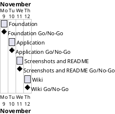

# Project Plan

## Metadata
| Key | Value |
| --- | --- |
| ID | PP-001 |
| CrossReference | [BC-001], [SA-001] |
| Language | en |
| Domain | it |

## Version History
| Date | Status | Author | Reviewer | Change | Commit |
| --- | --- | --- | --- | --- | --- |
| 2026-11-09 | Deprecated | Jens Tirsvad Nielsen | S01 | Initial version | [40ac86a] |
| 2026-11-09 | Accepted | Jens Tirsvad Nielsen | S01 (AI as stand-in) | Accepted after RC-003 (Go, autonomous, not independent) | [40ac86a] |

---

## Purpose

Schedules the four phases that deliver Coffee and Wifi (Day 62): the project foundation, the Flask application with tests, the screenshots with the README, and the trilingual wiki. One branch and one pull request per phase.

## Planning Assumptions

- The plan starts 2026-11-09 and ends by 2026-11-13, the delivery window in the Business Case Constraints. Source: S01 in chat on 2026-11-09 (autonomous mode request).
- Phase length: about one day. Source: the scope in the Business Case.
- The plan fits the constraint "one branch and pull request per milestone" of the Business Case.
- Owners and approving reviewers are S01 for every gateway; no governance document exists yet, so S01 holds all roles (Business Case Assumptions).

## Gateway Schedule

| Gateway | Document | Window | Decision date | Owner | Stories | Main deliverable | Milestone |
| --- | --- | --- | --- | --- | --- | --- | --- |
| Foundation | [MIL-001] | 2026-11-09 | 2026-11-09 | S01 | none (plain tasks) | Project skeleton, repository metadata, tooling | pending sync |
| Application | [MIL-002] | 2026-11-10 | 2026-11-10 | S01 | none (plain tasks) | Working Flask app with pytest suite | pending sync |
| Screenshots and README | [MIL-003] | 2026-11-11 | 2026-11-11 | S01 | none (plain tasks) | One screenshot per lecture step, README | pending sync |
| Wiki | [MIL-004] | 2026-11-12 | 2026-11-12 | S01 | none (plain tasks) | Wiki in en, da and ms | pending sync |



## Scope Coverage

| Business Case scope item | Gateway |
| --- | --- |
| `pyproject.toml`, `constants.py`, `.gitignore`, `Doxyfile`, `.venv` instructions, repository description and topics | MIL-001 |
| Flask application and pytest tests | MIL-002 |
| Screenshots and README | MIL-003 |
| Wiki in en, da and ms | MIL-004 |

## Dependencies

```
MIL-001 → MIL-002 → MIL-003 → MIL-004
```

## No-Go Handling

A No-Go on a gateway stops every later gateway (see Dependencies). The owner fixes the cause and the gateway is reviewed again. S01 decides any move of the end date, and records it as a new Version History row of this plan with the reason.

## Plan Risks

| Risk | Impact | Mitigation |
| --- | --- | --- |
| Starting-files link expired (Business Case risk 1) | Front-end must be rebuilt | MIL-001 task 2 falls back to rebuilding from the assignment text |
| Docker unavailable for screenshots (Business Case risk 4) | MIL-003 blocked | Stop and report; do not use the host desktop |

## Open Issues

- Whether the Udemy page can be compared to the result (login required in S01's browser).

---

[BC-001]: ./business-case.md
[SA-001]: ./stakeholder-analysis.md
[MIL-001]: ./milestones/mil-001-foundation.md
[MIL-002]: ./milestones/mil-002-application.md
[MIL-003]: ./milestones/mil-003-screenshots-readme.md
[MIL-004]: ./milestones/mil-004-wiki.md
[40ac86a]: https://git.tirsystem.com/Tirsvad-Udemy-100-days-of-code/062-coffee-and-wifi/commit/40ac86a92ce1d06f218c8f65b8faaee1d5cd018e
