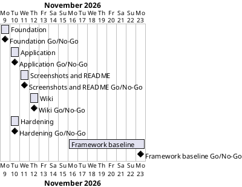

# Project Plan

## Metadata
| Key | Value |
| --- | --- |
| ID | PP-001 |
| CrossReference | [BC-001], [SA-001], [MIL-001], [MIL-002], [MIL-003], [MIL-004], [MIL-005], [MIL-006] |
| Language | en |
| Domain | education |

## Version History
| Date | Status | Author | Reviewer | Change | Commit |
| --- | --- | --- | --- | --- | --- |
| 2026-11-09 | Deprecated | Jens Tirsvad Nielsen | S01 | Add gateway MIL-005 Hardening after the OpenGrep notices; status column updated for the closed gateways | [ba840a5] |
| 2026-11-09 | Deprecated | Jens Tirsvad Nielsen | S01 (AI as stand-in) | Accepted after RC-014 (Go, autonomous, not independent) | [ba840a5] |
| 2026-11-16 | Accepted | Jens Tirsvad Nielsen | AI as stand-in for S01 | Added the baseline gateway G6 (MIL-006) with its schedule row, scope coverage, dependency, risk and Gantt entries; recorded the move of the end date, the domain, the open pull request #34 and the stale links of two review records in the Planning Assumptions and Open Issues; replaced the status words in the milestone column of MIL-001 to MIL-005 by the links to the milestones on the git host; set the domain to education; reviewed in autonomous mode, not independent | pending |

---

## Purpose

Schedules the five phases and, since the baseline gateway [MIL-006], a sixth that deliver Coffee and Wifi (Day 62): the project foundation, the Flask application with tests, the screenshots with the README, the trilingual wiki, and the hardening of the code scan findings. One branch and one pull request per phase.

## Planning Assumptions

- The plan starts 2026-11-09 and ends by 2026-11-13, the delivery window in the Business Case Constraints. Source: S01 in chat on 2026-11-09 (autonomous mode request).
- Phase length: about one day. Source: the scope in the Business Case.
- The plan fits the constraint "one branch and pull request per milestone" of the Business Case.
- Owners and approving reviewers are S01 for every gateway; no governance document exists yet, so S01 holds all roles (Business Case Assumptions).
- The baseline gateway G6 (MIL-006) starts 2026-11-16 and ends 2026-11-23, one week (source: [BC-001], Constraints). It brings the finished project to the baseline of the framework, a decision of S01. The decision dates of the earlier gateways stay as they were, so the end date of the plan moves from 2026-11-13 to 2026-11-23.
- For MIL-006 S01 has authorised the assistant to commit, push, open the pull request and merge it, and the review is done by an AI stand-in for S01 (source: [BC-001], Constraints and Risks).
- The PO language is English; the domain is IT until [MIL-006] and education since.

## Gateway Schedule

| Gateway | Document | Window | Decision date | Owner | Stories | Main deliverable | Milestone |
| --- | --- | --- | --- | --- | --- | --- | --- |
| Foundation | [MIL-001] | 2026-11-09 | 2026-11-09 | S01 | none (plain tasks) | Project skeleton, repository metadata, tooling | [Milestone 398][ms-398] |
| Application | [MIL-002] | 2026-11-10 | 2026-11-10 | S01 | none (plain tasks) | Working Flask app with pytest suite | [Milestone 399][ms-399] |
| Screenshots and README | [MIL-003] | 2026-11-11 | 2026-11-11 | S01 | none (plain tasks) | One screenshot per lecture step, README | [Milestone 400][ms-400] |
| Wiki | [MIL-004] | 2026-11-12 | 2026-11-12 | S01 | none (plain tasks) | Wiki in en, da and ms | [Milestone 401][ms-401] |
| Hardening | [MIL-005] | 2026-11-10 | 2026-11-10 | S01 | none (plain tasks) | CSV formula injection fixed and container base image pinned | [Milestone 407][ms-407] |
| Framework baseline | [MIL-006] | 2026-11-16 to 2026-11-23 | 2026-11-23 | S01 | none (technical tasks) | Branch `mil-006-framework-baseline` merged: the adopted framework release, the README, project URL metadata, `.editorconfig`, `.env.example`, the traceability matrix and review records | [Milestone 583][ms-583] |



## Scope Coverage

| Business Case scope item | Gateway |
| --- | --- |
| `pyproject.toml`, `constants.py`, `.gitignore`, `Doxyfile`, `.venv` instructions, repository description and topics | MIL-001 |
| Flask application and pytest tests | MIL-002 |
| Screenshots and README | MIL-003 |
| Wiki in en, da and ms | MIL-004 |
| Hardening of the OpenGrep findings | MIL-005 |
| The baseline: framework release, README, project URL metadata, editor settings, environment template, traceability matrix, review records (objective 6) | MIL-006 |

## Dependencies

```
MIL-001 → MIL-002 → MIL-003 → MIL-004
MIL-002 → MIL-005 (MIL-005 changes the code of MIL-002 and the image of MIL-003, and may run after MIL-004 is closed)
MIL-004 → MIL-006 and MIL-005 → MIL-006 (MIL-006 documents and baselines the finished program, so it follows both)
```

## No-Go Handling

A No-Go on a gateway stops every later gateway (see Dependencies). The owner fixes the cause and the gateway is reviewed again. S01 decides any move of the end date, and records it as a new Version History row of this plan with the reason.

## Plan Risks

| Risk | Impact | Mitigation |
| --- | --- | --- |
| Starting-files link expired (Business Case risk 1) | Front-end must be rebuilt | MIL-001 task 2 falls back to rebuilding from the assignment text |
| Docker unavailable for screenshots (Business Case risk 4) | MIL-003 blocked | Stop and report; do not use the host desktop |
| A continuous integration (CI) check fails on the pull request of MIL-006 | The merge is delayed past 2026-11-23 | The failure is fixed on the same branch and the checks run again; after three failed rounds on one cause the work stops and S01 decides (trace: success criterion 6 of [BC-001]) |

## Open Issues

- Whether the Udemy page can be compared to the result (login required in S01's browser).
- Domain: since [MIL-006] the plan, the Business Case and the baseline milestone have the domain `education`. The other documents (Stakeholder Analysis, milestones MIL-001 to MIL-005 and the review records RC-001 to RC-016) keep the domain `it` they were accepted with; they are not changed by the baseline, and a change of their domain would need a new review of each.
- The git host also has the open pull request #34 (framework submodule URL in lowercase); the baseline delivers the same change in the pull request of MIL-006. The baseline does not close #34 on the host; S01 decides what happens to it after the merge.
- The earlier review records RC-011 and RC-012 checked the wiki; MIL-006 checks it again against the current checklist (including the published wiki, criterion 14) and changes no page.
- The review records RC-013 and RC-014 used the references RC-001 and RC-003 as links without a link definition; MIL-006 adds the two definitions and changes nothing else in them.
- The code of the CSV repository carries one `nosemgrep` marker from [MIL-005]. The baseline leaves it as it is and does not add a suppression.
- The project had no traceability matrix; MIL-006 creates TM-001 for all documents.


---

[BC-001]: ./business-case.md
[SA-001]: ./stakeholder-analysis.md
[MIL-001]: ./milestones/mil-001-foundation.md
[MIL-002]: ./milestones/mil-002-application.md
[MIL-003]: ./milestones/mil-003-screenshots-readme.md
[MIL-004]: ./milestones/mil-004-wiki.md
[MIL-005]: ./milestones/mil-005-hardening.md
[40ac86a]: https://git.tirsystem.com/Tirsvad-Udemy-100-days-of-code/062-coffee-and-wifi/commit/40ac86a92ce1d06f218c8f65b8faaee1d5cd018e
[ba840a5]: https://git.tirsystem.com/Tirsvad-Udemy-100-days-of-code/062-coffee-and-wifi/commit/ba840a51f9f6ec2ac266cce649c16bd38b351af6
[ms-398]: https://git.tirsystem.com/Tirsvad-Udemy-100-days-of-code/062-coffee-and-wifi/milestone/398
[ms-399]: https://git.tirsystem.com/Tirsvad-Udemy-100-days-of-code/062-coffee-and-wifi/milestone/399
[ms-400]: https://git.tirsystem.com/Tirsvad-Udemy-100-days-of-code/062-coffee-and-wifi/milestone/400
[ms-401]: https://git.tirsystem.com/Tirsvad-Udemy-100-days-of-code/062-coffee-and-wifi/milestone/401
[ms-407]: https://git.tirsystem.com/Tirsvad-Udemy-100-days-of-code/062-coffee-and-wifi/milestone/407
[MIL-006]: ./milestones/mil-006-framework-baseline.md
[ms-583]: https://git.tirsystem.com/Tirsvad-Udemy-100-days-of-code/062-coffee-and-wifi/milestone/583
